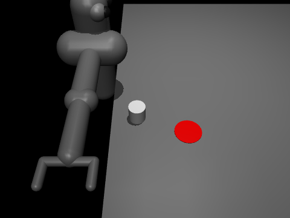
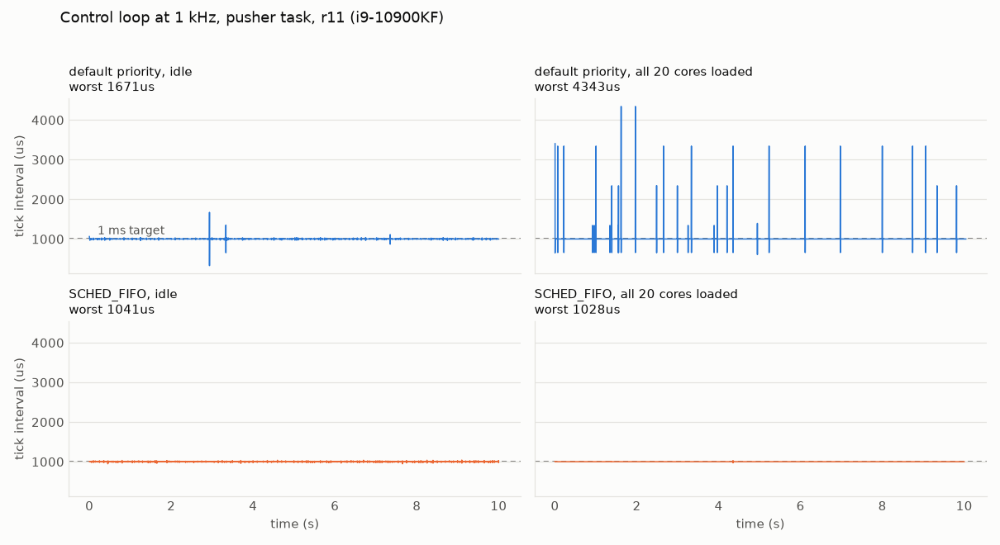

# ferro

A real-time control loop in C++ that drives a simulated robot in MuJoCo with an
ONNX policy, plus a Rust sidecar that collects per-tick telemetry over a
lock-free ring.



A 7-DOF arm pushing a puck 31 cm onto a goal, controlled by `ferro_cascade` at
1 kHz with a 20 Hz policy. The frames are rendered afterward from the state the
Rust sidecar logged during the run.

## Why

Robot control stacks run at two rates. The learned policy runs at 25-100 Hz and
joint control runs at 1-10 kHz. Inference cannot run in the fast loop, since
worst case inference measured 969us against a 1000us budget at 1 kHz.

`ferro_cascade` runs a 1 kHz control thread and a 20-25 Hz policy thread with a
lock-free handoff between them, and `ferro_core` keeps the single-loop version
for comparison. Tasks are a cart-pole and a 7-DOF pusher arm, each with a policy
trained in gymnasium.

## Results

Inference gets slower as the control rate drops, because of the idle gap between
ticks, so a tight loop reports 5.0us for a call that costs 85.4us at 50 Hz.

| period | Mac (ARM) | r11 (x86) |
|---|---|---|
| 50 Hz | 85.4us | 17.4us |
| 1 kHz | 20.8us | 12.4us |
| flat out | 5.0us | 8.6us |

That is 17x on Apple Silicon and 2x on x86, and core migration and frequency
scaling are both plausible causes.

Delaying every tenth policy command by 100 ms, at 1 kHz control on the Mac,
raised sensor-to-actuation latency 50x without moving control timing:

| pusher arm | no stall | 100 ms stalls |
|---|---|---|
| policy latency p99 | 2.0 ms | 102 ms |
| control tick p99 | 45.3us | 45.5us |
| missed deadlines | 0 | 0 |
| final object to goal | 0.3 cm | 0.3 cm |



`SCHED_FIFO` matters once the CPU is contended. On an idle machine both policies
hold 1 kHz with no missed deadlines. With all 20 cores saturated, default
priority missed 40 of 10,000 deadlines with a worst tick of 4.3 ms, while
`SCHED_FIFO` missed none and kept 99.9% of ticks within 1us of the period.

Telemetry push costs 0.5us per tick at p50 and 4us at p99.

Publishing `/joint_states` to a live ROS 2 subscriber at up to 1 kHz had no
measurable effect on the control loop. Over four runs each, control p99 ranged
41-53us with the bridge and 45-66us without, all with zero missed deadlines.

Whether a GPU helps depends on policy size. Same input and output shape as the
pusher policy at six widths, on r11's i9-10900KF and RTX 3090, p50 at 1 kHz:

| params | CPU | CUDA |
|---|---|---|
| 74k (pusher size) | 10us | 255us |
| 4.3M | 92us | 347us |
| 17M | 1344us | 298us |
| 67M | 6716us | 476us |

The GPU is 25x slower at the pusher's size, where launch and copy overhead
dominate, and wins from about 17M parameters, which is also where CPU inference
stops fitting a 1 kHz budget. Called at 50 Hz, CUDA settles near 650us at every
size, about 10x its back-to-back latency. Full results are in `bench/results/`.

Python holds 50 Hz but misses 37 of 2000 deadlines at 1 kHz with a worst tick of
8972us, and disabling the GC halves the work tail without changing wake
lateness.

On the pusher, the C++ loop lands the puck a mean of 1.0 cm from the goal over
20 seeds, against 0.6 cm for the same policy in gymnasium, with zero missed
deadlines across 100,000 ticks.

## Tech stack and architecture

- **C++20** for both loops. Deterministic timing and no garbage collector.
- **Rust** for the telemetry consumer, built as a staticlib and linked into the
  C++ binary. The two sides share a byte layout with static assertions on each.
- **MuJoCo** for physics, driven through its C API rather than Python.
- **ONNX Runtime** for inference, so the policy is independent of the framework
  that trained it.
- **CMake** driving both, including the cargo build.
- **ROS 2** (optional) for a bridge that publishes `/joint_states` and
  `/ferro/command`, built only when a ROS 2 environment is sourced.

```
+---------------------+   obs_ch (seqlock)   +---------------------+
|  control loop       | -------------------> |  policy thread      |
|  1 kHz, RT priority |                      |  20-25 Hz           |
|  MuJoCo mj_step     | <------------------- |  ONNX Runtime       |
+---------------------+   cmd_ch (seqlock)   +---------------------+
     |           |
     |           | state_ch (seqlock, optional)
     |           v
     |     +---------------------+
     |     |  ROS 2 bridge       |  /joint_states, /ferro/command
     |     +---------------------+
     |
     | tick_ring (SPSC FIFO, drops on full)
     v
+---------------------+
|  Rust sidecar       |
|  telemetry consumer |
+---------------------+
```

Telemetry needs every sample, so it is a queue with counted drops, while the
control loop only reads the newest command, where a queue would deliver stale
values after a stall.

[DESIGN.md](DESIGN.md) covers memory ordering, the layout contract, and
scheduling in more detail.

## Local setup

```
git clone git@github.com:calvinyz/ferro.git && cd ferro
./scripts/fetch_mujoco.sh
./scripts/fetch_onnxruntime.sh
cmake -B build && cmake --build build
./build/cpp_core/ferro_cascade --task pusher --trajectory run.csv
```

Dependencies are version pinned and checksum verified, so there is nothing to
install by hand. Built on macOS/AppleClang/ARM and Linux/GCC 13/x86_64.

`ferro_cascade` takes `--task cartpole|pusher`, `--ticks`, `--control-us`,
`--policy-us`, `--stall-ms`, `--die-after`, `--seed`, and `--trajectory`.
`ferro_core [ticks] [period_us]` and `ferro_eval [episodes] [seed]` run the
cart-pole only. To render a logged run, from `training/`:

```
uv run python render_trajectory.py ../run.csv ../third_party/models/pusher.xml run.gif --camera pusher
```

For the CPU and GPU inference sweep on Linux with an NVIDIA GPU, run
`fetch_onnxruntime.sh --gpu`, export models with `training/export_width_sweep.py`,
then `scripts/cuda.sh build` and `scripts/cuda.sh sweep out.csv`.

Tests are `target_channel_test`, `ring_stress_test`, `sidecar_link_test`,
`cargo test` in `rust_sidecar/`, and `training/check_obs_parity.py`, which checks
the C++ tasks against gymnasium.

To run with the ROS 2 bridge on Linux, `scripts/ros.sh build` and then
`scripts/ros.sh run --task pusher --ros-hz 100`, which builds and runs inside a
`ros:jazzy` container.

`SCHED_FIFO` on Linux needs `sudo setcap cap_sys_nice+ep` on the binary, and
rebuilding clears it.

## Next steps

- Run the ring under ThreadSanitizer, since the stress test cannot check
  ordering.
- Train a policy large enough to need the GPU. The sweep uses random weights,
  and the trained pusher policy is small enough that the CPU is 25x faster.
- Lock GPU clocks to test whether the 50 Hz CUDA floor comes from power states.
- Train the pusher on a realistic puck. Pusher-v5's puck weighs 8 mg, so the
  gripper sinks into it in the GIF, and at 78 g the current policy misses by
  32 cm, meaning it learned to exploit the weightless puck.
- Replace the stale-command fallback. Decaying force to zero drops the pole,
  which tests the mechanism but is not a usable policy.
- Move the sidecar into its own process over shared memory. Right now the ring
  lives in the producer's address space.
